# Week 3 – Password Cracking Labs (JTR + NetworkWalks Tools)


Two practical labs from the **NetworkWalks Cybersecurity & Ethical Hacking Program**: recovering the password of a protected PDF using two different approaches — **John the Ripper (JTR) with Johnny**, and **NetworkWalks' own browser-based Hash Calculator and Password Cracker**.

## Table of Contents

1. [Overview](#overview)
2. [Lab Information](#lab-information)
3. [Repository Structure](#repository-structure)
4. [Module 1: Password Cracking with JTR](#module-1-password-cracking-with-jtr)
5. [Module 2: Password Cracking with NetworkWalks Tools](#module-2-password-cracking-with-networkwalks-tools)
6. [Bonus: Cracking an Additional PDF](#bonus-cracking-an-additional-pdf)
7. [Technical Concepts](#technical-concepts)
8. [Learning Outcomes](#learning-outcomes)
9. [Ethical Disclaimer](#ethical-disclaimer)
10. [Author](#author)

## Overview

Both modules solve the same underlying problem — recovering the password of a locked PDF — using two different tool stacks:

- **Module 1** uses **John the Ripper (JTR)** and its graphical front-end **Johnny**, installed locally on Windows.
- **Module 2** uses **NetworkWalks' own online Hash Calculator and Password Cracker**, entirely in the browser with no installation required.

A bonus section at the end shows the same workflow applied to a second locked PDF.

## Lab Information

| Field | Detail |
|---|---|
| Program | Cybersecurity & Ethical Hacking Internship / Practical Training |
| Organization | NetworkWalks Academy |
| Week | Week 3 |
| Modules | Project Module 1 (JTR) & Project Module 2 (NW Tools) |
| Platform | Windows / Web Browser |
| Target File | `My Locked PDF1.pdf` |

**Authorization and Scope:** These exercises were assigned by my instructor as part of the NetworkWalks training program and performed only on the files provided for the lab. The techniques shown here should only be used on files and systems you have explicit permission to test.

## Repository Structure

```text
week3-password-cracking-labs/
├── README.md
├── 01-johnny-settings-empty.png
├── 02-browsing-downloaded-files.png
├── 03-selecting-john-exe.png
├── 04-extracting-hash-onlinehashcrack.png
├── 05-opening-password-file-in-johnny.png
├── 06-password-cracked-result.png
├── 07-hash-calculator-opened.png
├── 08-hash-extracted-pdf3.png
├── 09-password-cracker-opened.png
├── 10-password-cracked-password1.png
├── 11-password-verified.png
├── 12-bonus-pdf3-opening-in-johnny.png
├── 13-bonus-pdf3-cracked-result.png
├── 14-flag-cybersecurity-2608.png
├── 15-flag-jtr-270521-1.png
├── 16-flag-persistence-jtr.png
└── 17-flag-260821-1.png
```

---

## Module 1: Password Cracking with JTR

### Tools Used

| Tool | Role |
|---|---|
| **John the Ripper (JTR)** | Core password-cracking engine that tests candidate passwords against a hash |
| **Johnny** | Graphical front-end for JTR, so the attack can be run without command-line syntax |
| **Online Hash Extractor** | Converts the locked PDF into a crackable `$pdf$...` hash before feeding it to JTR |

### Lab Workflow

**Step 1 – Install JTR and Johnny**
Downloaded John the Ripper and the Johnny GUI, and installed Johnny on a Windows PC.

**Step 2 – Point Johnny to the JTR executable**
Opened Johnny's Settings tab, which initially showed no valid John the Ripper executable path. Browsed to the extracted JTR folder and selected `john.exe` from its `run` folder.

**Step 3 – Extract the hash from the locked PDF**
Uploaded the protected PDF to an online PDF hash extractor, which generated the file's password hash in the `$pdf$...` format.

**Step 4 – Load the hash into Johnny**
Opened the saved hash file in Johnny as the password file to attack.

**Step 5 – Run the attack**
Started the attack in Johnny and let it test candidate passwords against the hash.

**Step 6 – Recover and verify the password**
Johnny returned the cracked password. Used it to open the original locked PDF and confirmed it unlocked successfully.

### Screenshot Evidence

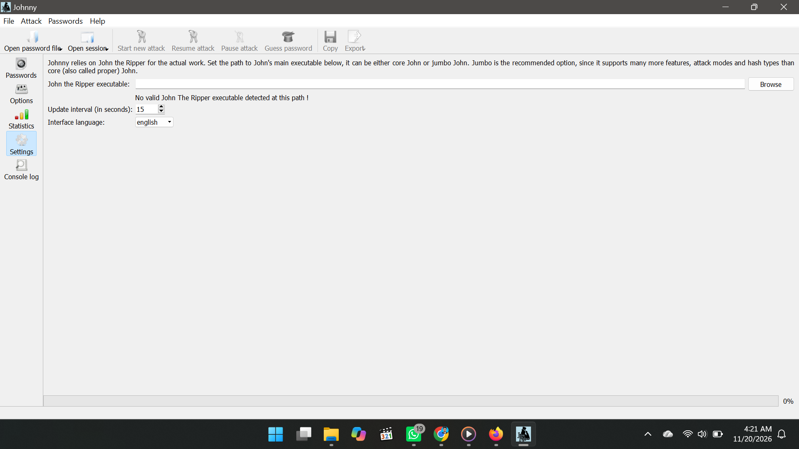
*Johnny opened for the first time, with no valid JTR executable path set.*

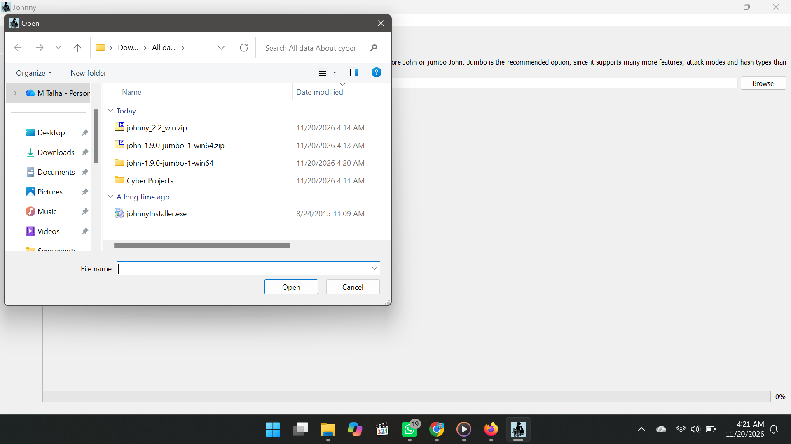
*Browsing to the downloaded and extracted John the Ripper folder.*

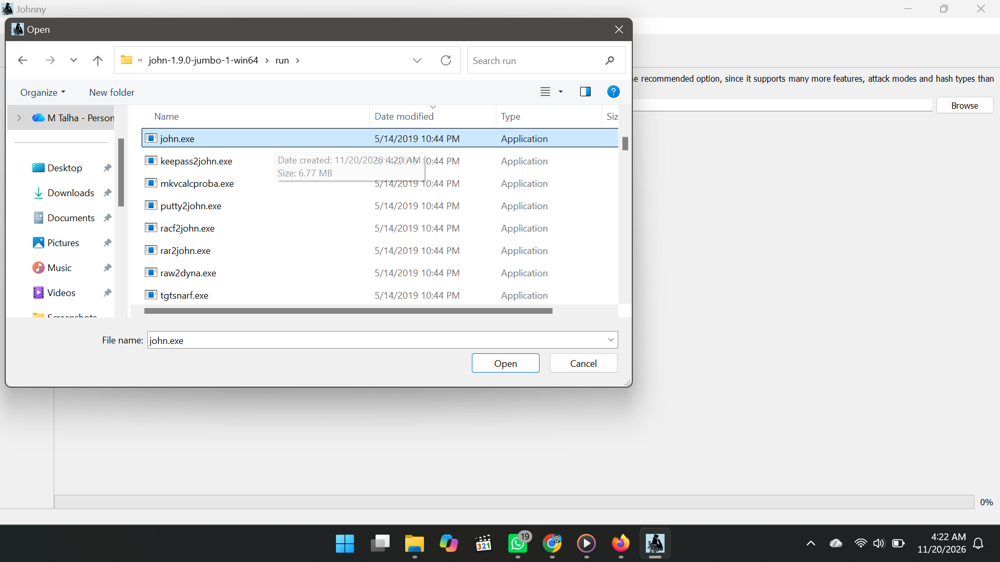
*Selecting `john.exe` from the `run` folder to set as Johnny's executable.*

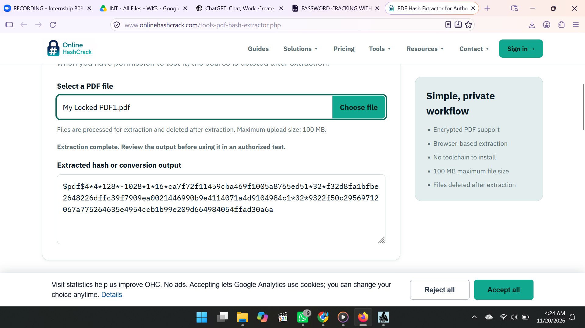
*Using an online PDF hash extractor to generate the crackable `$pdf$...` hash.*

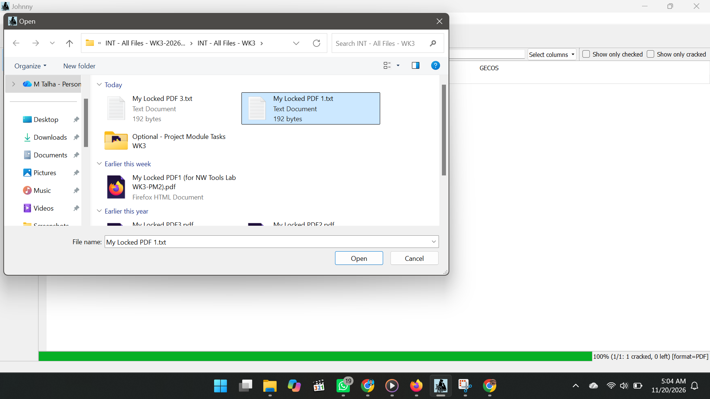
*Opening the saved hash file in Johnny to begin the attack.*

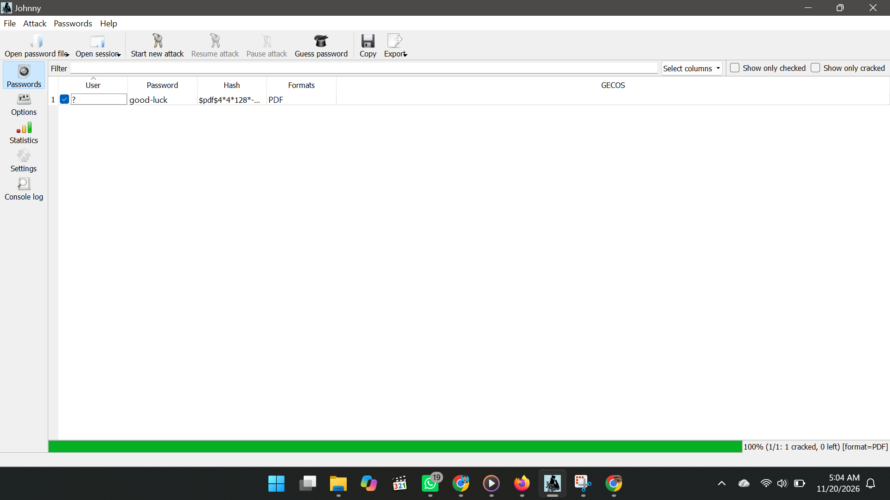
*Johnny showing the recovered password after the attack completed.*

### Result

The password for `My Locked PDF1.pdf` was successfully recovered using John the Ripper and Johnny, and verified by reopening the PDF with the cracked password.

---

## Module 2: Password Cracking with NetworkWalks Tools

### Tools Used

| Tool | Role |
|---|---|
| **NetworkWalks Hash Calculator** | Extracts the password hash from the protected PDF |
| **NetworkWalks Password Cracker** | Tests a wordlist against the extracted hash to recover the password |

### Lab Workflow

**Step 1 – Open the Hash Calculator**
Opened the NetworkWalks Hash Calculator in a web browser.

**Step 2 – Extract the hash**
Switched to the PDF tab and uploaded the locked PDF. The tool parsed it locally in the browser and returned a crackable hash in the `$pdf$...` format.

**Step 3 – Open the Password Cracker**
Opened the NetworkWalks Password Cracker and pasted the hash into the input field, keeping the built-in 100-password wordlist active.

**Step 4 – Run the attack**
Started the attack. The tool tried each password in the list against the hash.

**Step 5 – Password recovered**
After 91 of 100 attempts, the tool found a match and displayed the cracked password.

**Step 6 – Verify the result**
Opened the original locked PDF and entered the recovered password, confirming it unlocked the file.

### Screenshot Evidence

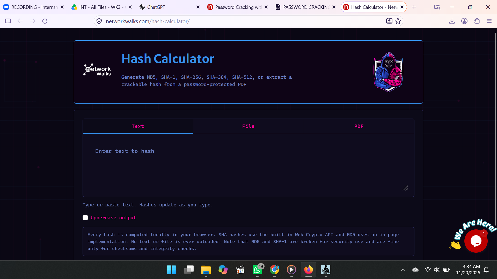
*The NetworkWalks Hash Calculator, opened on its default Text tab.*

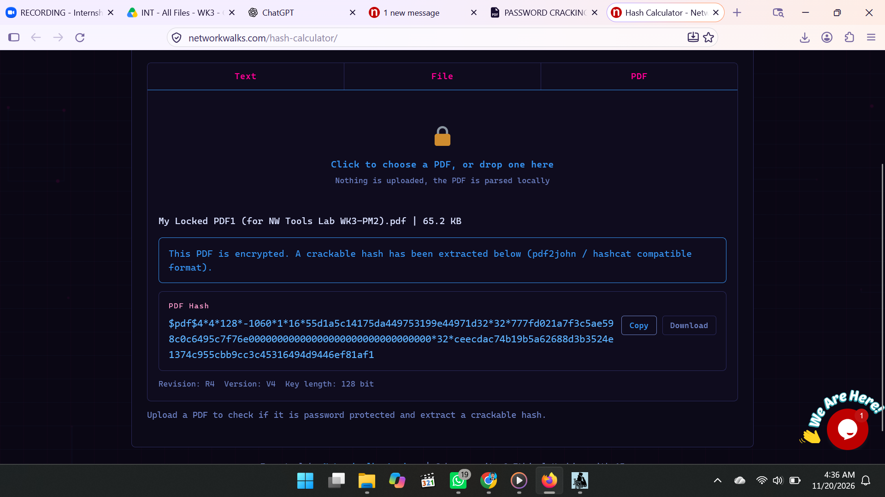
*After switching to the PDF tab and uploading the locked file, the tool confirmed it was encrypted and generated the crackable hash.*

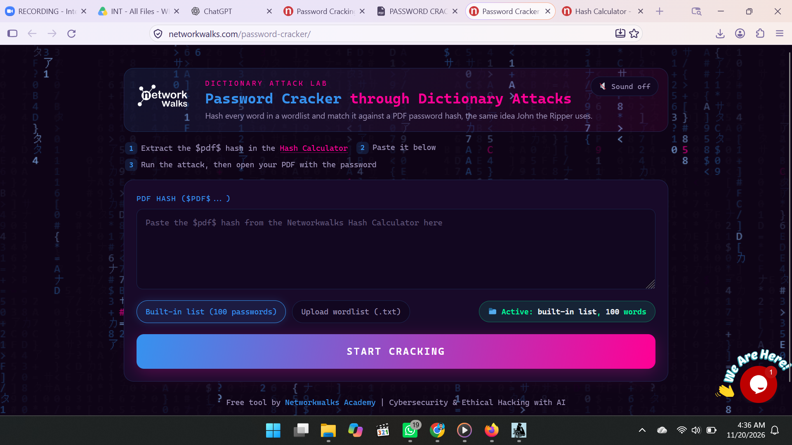
*The NetworkWalks Password Cracker, ready to accept the extracted hash.*

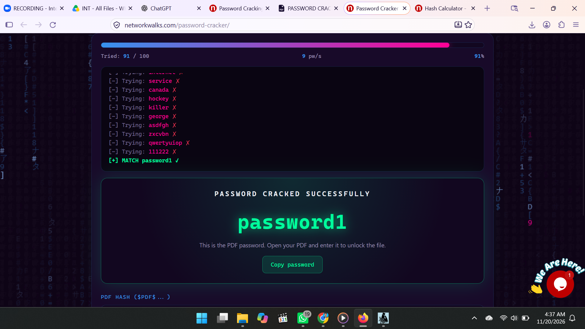
*The attack completed after 91 of 100 attempts, returning the cracked password.*

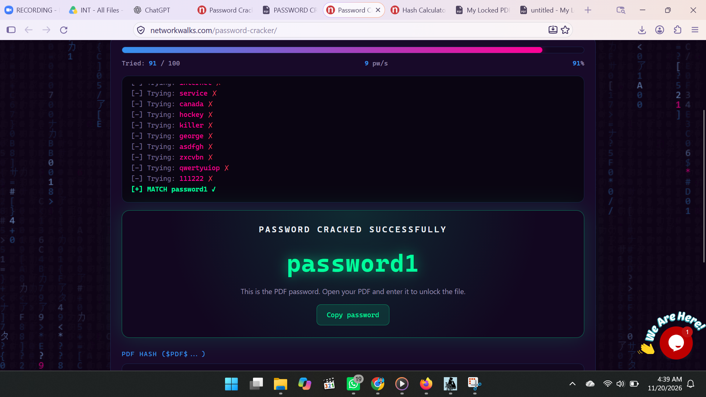
*The recovered password confirmed again, with the original PDF opened in another tab.*

### Result

The password for `My Locked PDF1.pdf` was successfully recovered entirely through NetworkWalks' browser-based Hash Calculator and Password Cracker, and verified by reopening the PDF with the recovered password.

---

## Bonus: Cracking an Additional PDF

As extra practice, the same Johnny workflow from Module 1 was repeated on a second locked file, `My Locked PDF 3.txt`, to confirm the process works consistently across different password hashes.

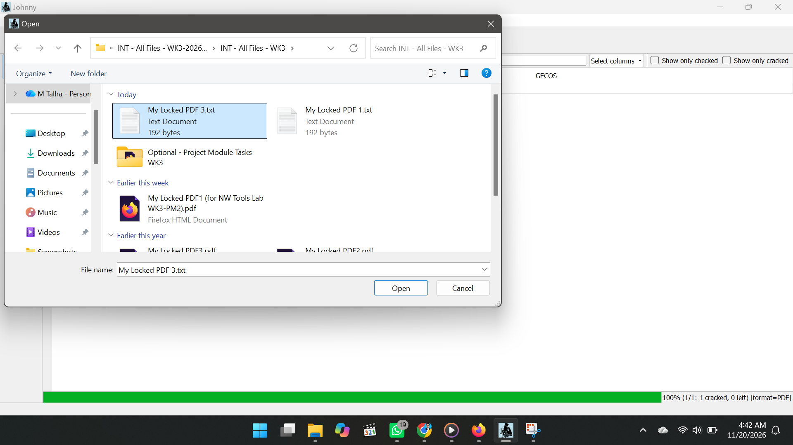
*Opening the saved hash file for the second locked PDF in Johnny.*

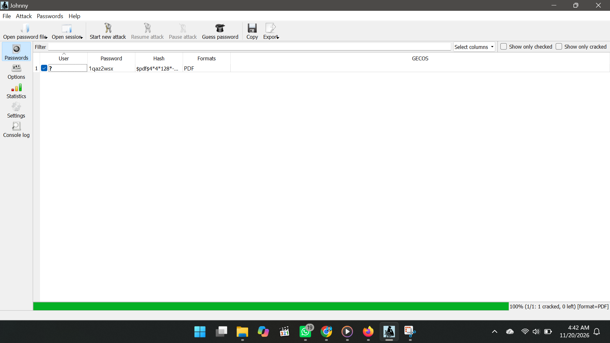
*Johnny recovering the password for the second file.*

---

## Technical Concepts

- **Password-protected PDF:** A PDF encrypted so opening it requires a password, enforced by the PDF's own security handler.
- **Hash extraction:** Converting a file's password protection into a hash value, so a cracking tool can test guesses against it without repeatedly opening the real file.
- **The `$pdf$` format:** The hash notation produced by PDF hash-extraction tools, encoding the file's encryption parameters alongside the hash.
- **Hashing vs. encryption:** Encryption is reversible with the right key; the extracted hash is one-way and used only for testing guesses, not for decrypting the file directly.
- **Dictionary/brute-force cracking:** Both JTR and the NetworkWalks Password Cracker hash each candidate password and compare it to the target hash, rather than reversing the hash itself.

## Learning Outcomes

- Understanding how password-protected PDFs enforce access control.
- Learning how to extract a crackable hash from a protected file, using two different tools.
- Setting up and configuring Johnny to work with the JTR engine.
- Running password-cracking attacks and interpreting the results.
- Comparing a locally installed tool (JTR) against a fully browser-based tool (NetworkWalks Tools).
- Understanding why password complexity directly affects how long cracking takes.
- Practical experience documenting a security exercise in an authorized training environment.

## Ethical Disclaimer

This practical was conducted for educational purposes within an authorized NetworkWalks training environment. Password-cracking tools demonstrated here should only be used against files, systems and data you have explicit permission to test. This repository does not endorse unauthorized password cracking of any kind.

## Author

**Muhammad Talha**
Cybersecurity Intern — NetworkWalks Cybersecurity & Ethical Hacking Program

- GitHub: [@infomuhammadtalha](https://github.com/infomuhammadtalha)
- LinkedIn: [Muhammad Talha](https://www.linkedin.com/in/muhammad-talha-98b39b279/)
